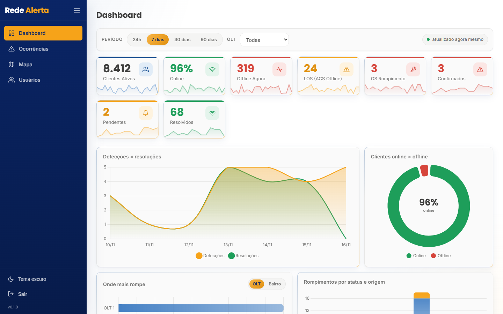
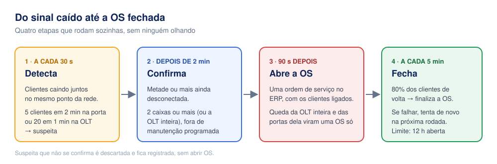
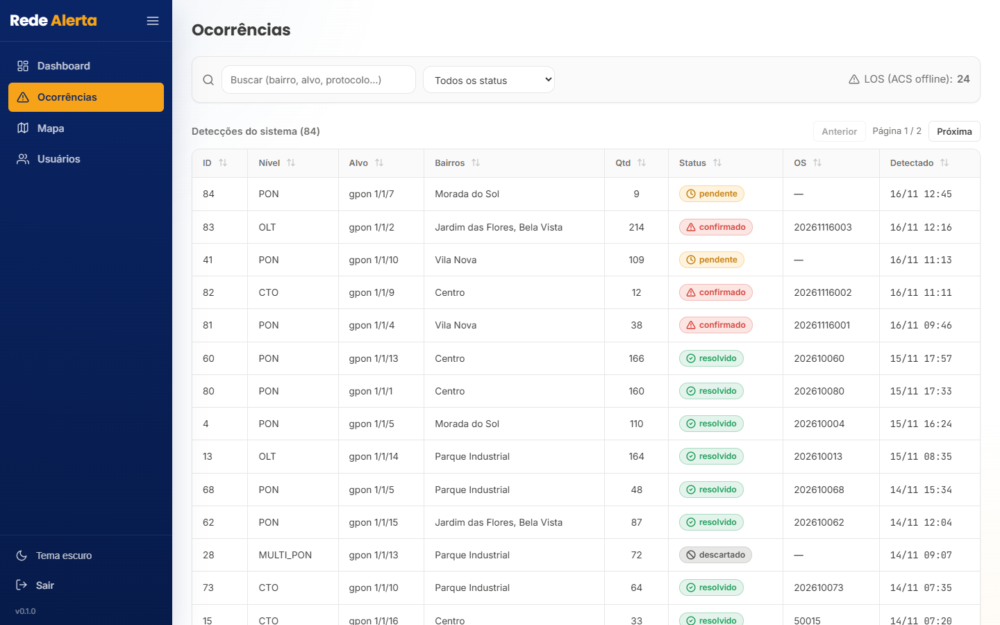
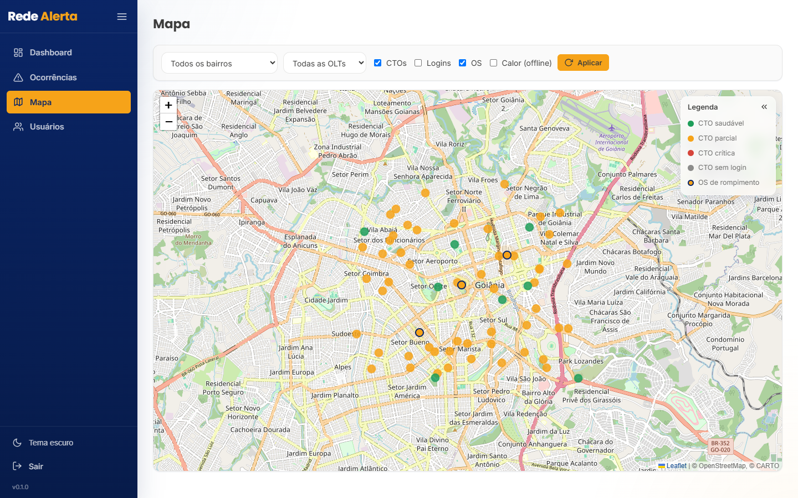
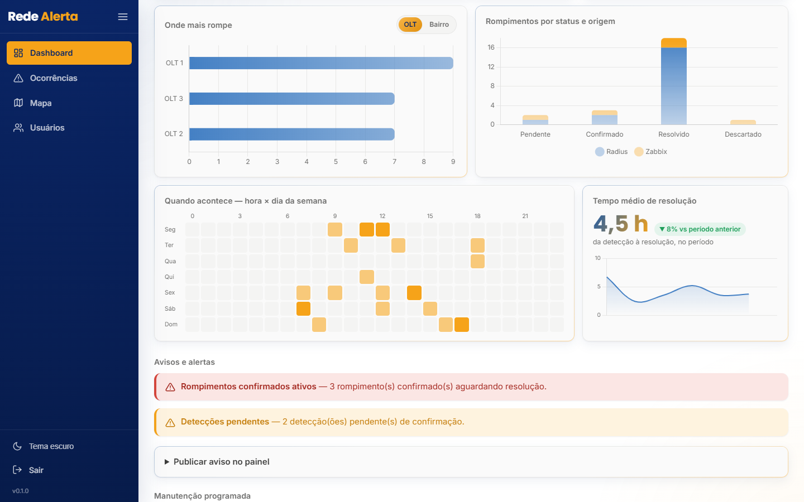
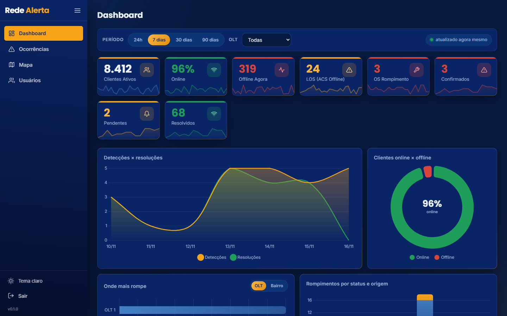
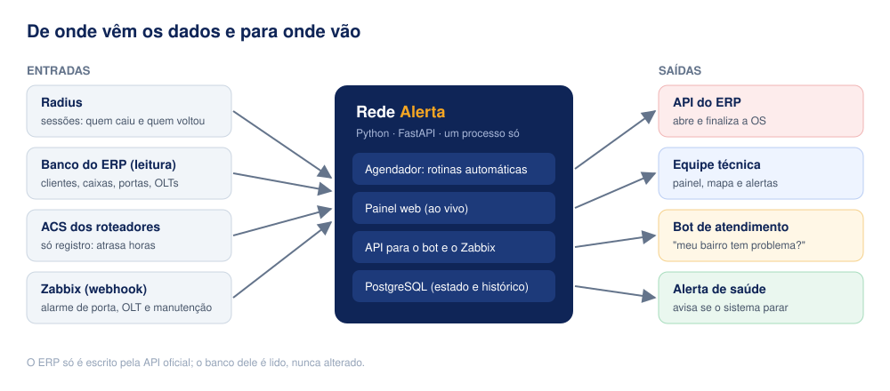

# Detecção de rompimento de fibra

Fiz este sistema para um provedor de internet saber, sozinho e em poucos minutos, quando uma fibra rompeu e quem ficou sem sinal. Ele está em produção. O código é da empresa, então aqui ficam a história, as telas e os diagramas.

## O problema

Quando um cabo rompe, dezenas ou centenas de clientes caem ao mesmo tempo. Antes, a empresa descobria pelo telefone tocando. Alguém precisava juntar os chamados, adivinhar o tamanho do problema e abrir a ordem de serviço à mão. Às vezes saíam várias OS para o mesmo rompimento, e o atendimento não sabia o que responder ao cliente.

## O que o sistema faz

A cada 30 segundos ele olha quem desconectou e agrupa as quedas pelo ponto da rede: caixa, porta ou OLT inteira. Se muita gente caiu junto no mesmo lugar, vira uma suspeita. Dois minutos depois ele confere de novo. Se a queda continua e pega mais de uma caixa (ou a OLT inteira), ele abre uma OS no ERP com todos os clientes atingidos. Quando os clientes voltam, ele finaliza a OS.

Ninguém precisa apertar botão. O painel serve para acompanhar.

A tela de ocorrências mostra cada detecção, o nível (caixa, porta ou OLT), os bairros, quantos clientes caíram e a OS aberta. Atualiza sozinha e avisa quando chega uma nova.

O mapa mostra as caixas pela situação dos clientes e onde há OS de rompimento aberta.

O dashboard mostra onde mais rompe, em que dia e hora acontece e quanto tempo leva para resolver. Também tem tema escuro.

O bot de atendimento também consulta o sistema. Quando um cliente escreve dizendo que está sem internet, o bot pergunta se ele está dentro de um rompimento e responde com o número da OS e a previsão de reparo.

## Como as peças se ligam

## O que deu trabalho

- **O sinal do roteador chega atrasado.** A primeira versão confirmava o rompimento pelo status do roteador, que atrasa horas. Ela descartava quase todos os rompimentos reais. Passei a decidir pelo Radius, que mostra a conexão na hora, e deixei o roteador só como registro.
- **Uma caixa sozinha não é rompimento.** Um defeito numa caixa isolada abria OS como se fosse problema de rede. Agora o sistema só confirma quando a queda atinge pelo menos duas caixas ou a OLT inteira. Antes de mudar, rodei a regra nova nos eventos antigos, sem gravar nada, para ver quantos ela mudaria.
- **Uma queda, uma OS.** Quando a OLT inteira cai, cada porta dela também parece ter caído. No primeiro evento grande saíram dez OS para um problema só. Refiz a regra pela topologia: as portas aguardam e entram na OS da OLT.
- **Manutenção programada virou rompimento.** Numa manutenção planejada, o sistema abriu OS para milhares de clientes e o bot leu ao cliente uma previsão já vencida. Criei janelas de manutenção no painel: dentro delas não sai OS e o bot informa a manutenção com o horário real.
- **O bot inventava resposta.** Quando a consulta falhava, a IA do bot preenchia a lacuna e "anunciava" um rompimento que não existia. Mudei a consulta para nunca devolver erro: na dúvida, ela responde "sem rompimento" de forma clara.
- **Conexão presa travando tudo.** Uma conexão com o banco ficava presa e travava as rotinas sem dar erro. Coloquei prazo em cada rodada, tempo-limite nas consultas e um alerta externo que avisa se o sistema parar de responder.

## Tecnologias

Python, FastAPI, PostgreSQL, APScheduler, Jinja2, Alpine.js, Chart.js, Leaflet e Docker.

## Em números

5 meses de trabalho, 62 commits e 314 testes automatizados.

---

As telas usam dados fictícios.
